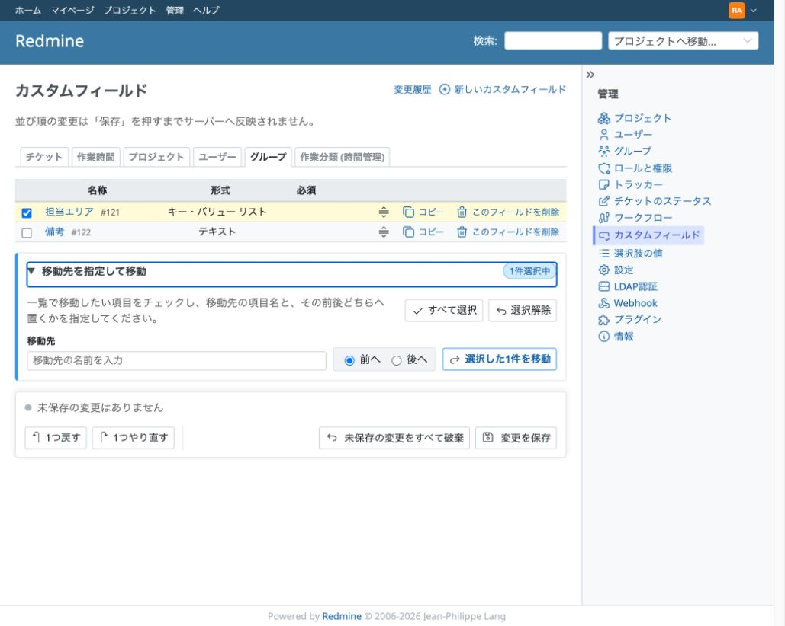
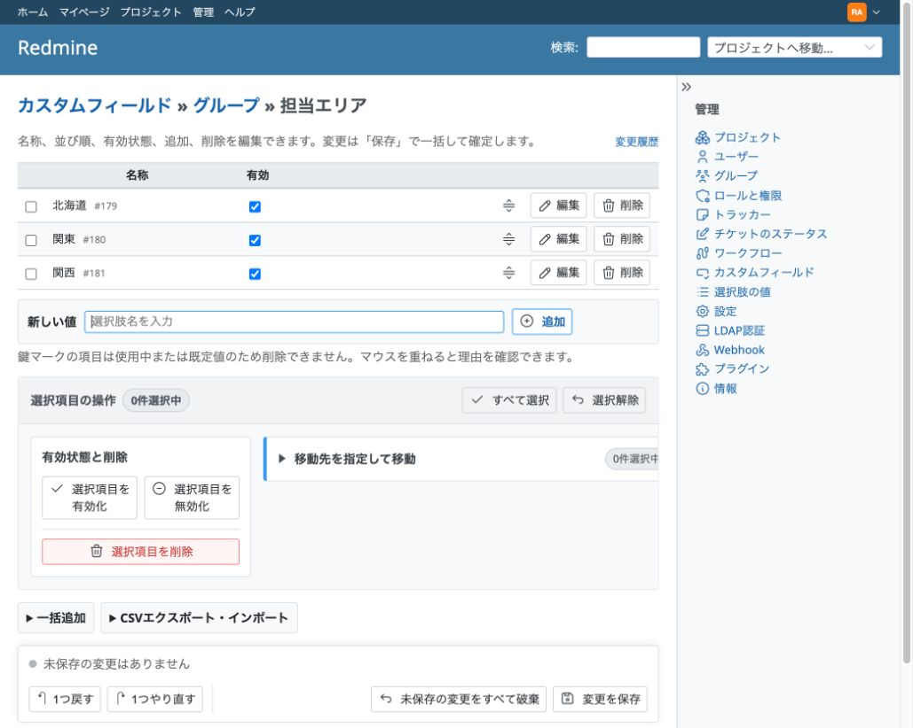
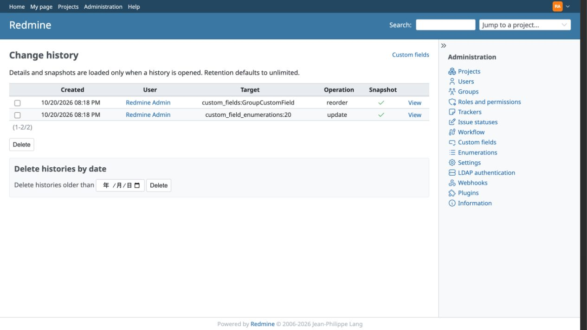

# Redmine Custom Field Manager

[日本語](README.ja.md)

Redmine Custom Field Manager is a Redmine plugin for safely managing custom-field order and large Key/value lists. It keeps Redmine's familiar administration screens while adding staged bulk editing, CSV workflows, conflict handling, and restorable history.

Version `0.1.0` is currently a development release. This English README is the canonical project overview and operating guide; [`docs/specification.md`](docs/specification.md) remains the source of truth for product behavior.

## What changes after installation

The plugin enhances **Administration → Custom fields** instead of adding a separate management area.

- The custom-field list is fully visible and can be reordered with drag and drop or multi-selection.
- All edits stay in the browser until **Save** is pressed. Undo, redo, reset, and an unsaved-change warning are available.
- Existing create, edit, copy, and delete actions remain available.
- A Key/value list can be renamed, activated or deactivated, reordered, added to in bulk, and safely deleted from a single staged editor.
- Key/value lists can be exported to CSV and imported in append, update, or full-synchronization mode, with a preview before anything is written.
- Concurrent edits are detected. The plugin displays the editing baseline, your changes, and the current server state instead of silently overwriting another administrator's work.
- Every successful save records a change history. Administrators can preview and restore an entire field-order scope or Key/value list.

The screenshots below use Redmine 7.0 with the English locale. Labels may differ with the Redmine version or selected language.

### Staged custom-field ordering

Select several fields and move them before or after a named destination, or drag individual rows. A unique destination can be entered by name alone. If names are duplicated, the page presents clickable choices labeled with their current list positions; users never need to know or enter an internal ID. IDs remain visible only as supplementary information. The selection counter, status line, and **Save** button make it clear what is selected and that the new order has not yet reached the database.



### Key/value list manager

The list editor supports inline renaming, activation, deactivation, deletion, drag and drop, multi-selection, bulk addition, and CSV export/import. Locked values show why they cannot be deleted. The summary reports every pending change before the atomic save.



### Change history and restore

Open **Change history** from either enhanced screen to inspect recorded saves, preview a whole-target restore, or remove old history. Retention is unlimited by default and can be limited by age or generation count in the plugin settings.



## Data safety

Installing the plugin does not rewrite existing custom fields, enumeration IDs, or stored custom values. Its migrations create only plugin-owned `rcfm_*` tables for revisions, history, instance metadata, and confirmed cross-instance import mappings.

Normal saves intentionally update Redmine's standard custom-field and enumeration records, while preserving existing IDs. A value that is currently referenced, or used as a default, cannot be deleted; the complete save is rejected rather than partially applied. Reordering, bulk edits, imports, and restores are committed atomically with their history records.

Removing or disabling the plugin does not remove Redmine's standard custom fields, enumerations, or values already stored on issues and other objects. The plugin-owned `rcfm_*` tables are left in place and ignored by Redmine, so history is not destroyed accidentally. Do not blindly run a migration rollback to version zero: the current history-column expansion is intentionally irreversible because shrinking it could truncate stored snapshots. Take a database backup and have a database administrator review any permanent cleanup of plugin-owned tables.

## Supported versions

- Redmine 7.0.x
- Redmine 6.1.x
- Redmine 6.0.x

CI currently tests Redmine 7.0.2, 6.1.5, and 6.0.11 with SQLite, MySQL 8.4, MariaDB 11.4, and PostgreSQL 17. Newly released Redmine series are supported only after compatibility testing.

## Installation

1. Back up the Redmine database.
2. Place this repository at `plugins/redmine_custom_field_manager` under the Redmine root. The directory name must stay `redmine_custom_field_manager`.
3. From the Redmine root, run:

   ```sh
   bundle exec rake redmine:plugins:migrate RAILS_ENV=production
   ```

4. Restart Redmine.
5. Sign in as an administrator and open **Administration → Custom fields**.

For an update, replace the plugin files while Redmine is stopped, run the same migration command, and restart Redmine. Back up the database before every production update.

## Usage

### Reorder custom fields

1. Open **Administration → Custom fields** and select a field-type tab.
2. Drag a row, or select multiple rows and enter a destination field name.
3. Choose **Before** or **After**, then move the selection. If several destinations have the same name, click the choice identified by its current list position.
4. Review the pending state. Use **Undo**, **Redo**, or **Cancel** if needed.
5. Press **Save** to commit the complete order for that field type.

All fields remain ordinary text in the page, so browser find (`Ctrl+F` / `⌘+F`) continues to work even for large lists.

### Edit a Key/value list

Open the values of a custom field whose format is **Key/value list** from the standard custom-field screen. Changes to names, active state, order, additions, and deletions remain staged until **Save** is pressed.

Values already in use cannot be deleted. Deactivate them instead. Usage is checked again immediately before saving; if the state has changed, the entire operation is stopped and nothing is partially written.

### Import or export CSV

Expand **CSV export/import** in the Key/value list editor.

- **Append** creates a new value for every CSV data row.
- **Update and add** updates same-instance IDs and creates rows without a local ID.
- **Full synchronization** also handles local values missing from the CSV. Used values can only be deactivated; unused values can be deleted or deactivated.

Use **Download an empty CSV template** to start a new file with the correct columns and metadata for the current field. Save or discard any on-screen changes before exporting or previewing an import; CSV operations use the saved database state.

Every import requires a difference preview before apply. For a CSV from another Redmine instance, foreign IDs are never treated as local IDs. The administrator must confirm candidate mappings or choose to create new values; confirmed mappings can be reused by later imports.

### Resolve concurrent edits

If another administrator saves the same target first, your next save opens a conflict panel and preserves your unsaved work. You can continue editing, discard and reload, review a safe three-way merge when one exists, or explicitly force your version. A merge is never applied without confirmation, and a force save cannot bypass deletion safeguards.

### Review and restore history

Use **Change history** on either enhanced administration screen. Targets, operations, and before/after states are shown with human-readable labels; raw JSON is kept in a collapsed technical section. A restore first displays a difference preview, including active/inactive state, and then restores the entire target, not selected individual changes. The restore itself is recorded. If the target changed after preview, or restoring would require an unsafe deletion, the complete restore is rejected.

Configure retention under **Administration → Plugins → Redmine Custom Field Manager → Configure**. Empty retention fields mean unlimited storage.

## Development and testing

Run the plugin test suite from a Redmine root containing this plugin:

```sh
bundle exec rake redmine:plugins:test NAME=redmine_custom_field_manager RAILS_ENV=test
```

The GitHub Actions matrix also runs real row-lock concurrency tests on MySQL, MariaDB, and PostgreSQL, plus Playwright browser behavior tests on Redmine 7.0.2. See [`docs/implementation.md`](docs/implementation.md) for implementation notes and [`docs/performance.md`](docs/performance.md) for the recorded 10,000-item benchmark.

## License

The license will be finalized before the first stable release. At present, publishing this repository does not grant permission to use, modify, or redistribute its contents.
